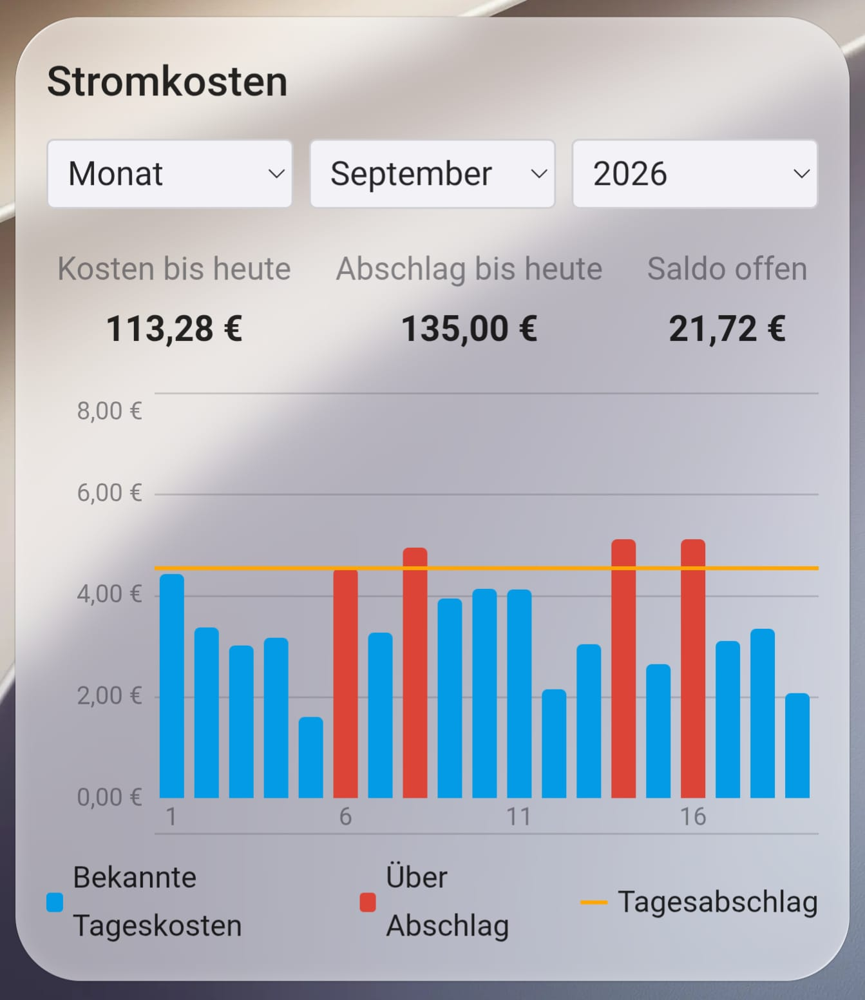

# energycosttracker
Database for displaying historical tariffs, payments, and consumption.
A Home Assistant custom integration for calculating electricity costs based on daily energy consumption.



# Configuration
After installation, configure tariffs and payments with their corresponding periods in the integration settings.
In the integration settings, under **Configure consumption recording**, select an energy sensor with device class `energy` and unit `kWh`. Power sensors and energy sensors with other units are not supported.
Then add payment periods and tariffs, including their validity periods.

Finally, add the Lovelace card to one of your dashboards.
In the dashboard editor, add the card using **Add card → energycosttracker**. In storage-mode dashboards, the integration manages its JavaScript module as a dashboard resource and updates its cache-busting URL when the card changes. Do not add a second manual resource. YAML-mode dashboards continue to load the card through Home Assistant's extra-module mechanism.

# Features

- Record daily electricity consumption
- Import historical energy and base prices
- Calculate daily, monthly, and yearly costs
- Display costs and payments as a chart card

## How it works

The integration is located at `custom_components/energycosttracker`. It provides native options in Home Assistant for managing tariff and payment periods. You can add, edit, and delete names, start dates, optional end dates, and amounts. A note can also be added to payments.

The **Current energy price** sensor provides the work price of the tariff valid for today's local date in `EUR/kWh`. It is updated at startup, when tariffs change, and at local midnight. If no tariff is valid today, the sensor keeps displaying its last valid price; if no valid price has ever been seen or restored, its state is `unknown`. A successful lookup with no matching tariff keeps the sensor available. A database access error makes it unavailable while retaining the last valid price internally; it retries automatically and becomes available again when the database can be read.

The meter reading is recorded every 10 minutes when a consumption sensor is configured. The reading at the end of the interval and the previous reading from the same sensor are stored in the `meter_intervals` table in the `energy_cost_tracker.db` database. The first reading from a sensor has no starting meter reading; decreasing meter readings result in unknown consumption in the Lovelace calculation. Missing, unavailable, unknown, or otherwise invalid readings are not stored; recording resumes automatically on a later interval when the configured sensor provides a valid reading. Writer errors are logged and do not prevent the price sensor from being set up.

Daily and monthly costs are based on the same intervals. Intervals that cross local midnight, month boundaries, or tariff boundaries are split according to their elapsed UTC time. This assumes uniform consumption over the interval; it does not add another measurement. The final portion receives the remaining amount so that the portions add up to the original consumption. Calculations use decimal values without intermediate rounding. Under the existing rule, base costs are calculated as the monthly base price divided by the number of calendar days in the month, even when consumption data is missing. Known base and consumption costs are shown separately; consumption that cannot be reconstructed remains unknown when data is missing.

Tariff management reads and updates the tables in `energy_cost_tracker.db` directly. The database is stored in the Home Assistant configuration directory alongside `configuration.yaml`.

## Lovelace card
While the integration is set up, the card module is loaded automatically in the Home Assistant frontend. The card follows the Home Assistant Energy dashboard date range through its `EnergyCollection`; it does not provide a separate date selector. Configure the same collection key used by the Energy dashboard:

```yaml
type: custom:energycosttracker-card
collection_key: energy_dashboard
```

The default key is `energy_dashboard`. Collection keys must begin with `energy_`, and independent Energy collections can be selected to support multiple trackers. The chart automatically displays daily values for ranges up to 32 days, monthly values for ranges of 33–699 days, and yearly values from 700 days onward. Comparison periods are ignored. Cost and payment calculations retain local-day boundaries, the applicable tariff and payment periods, and daylight-saving-time handling.

The visual editor lets you set the card width as a percentage (10–100%), the Energy collection key, and the colors for costs under and over the payment amount. The default colors are blue (`#03a9f4`) and red (`#db4437`).


## Data structure
All user data is stored in `energy_cost_tracker.db`. The database contains the following tables:

### meter_intervals
`[id, interval_start_utc, interval_end_utc, consumption_meter_kwh, consumption_meter_start_kwh, note]`

### tariffs
`[id, name, valid_from, valid_until, work_price_per_kwh, base_price_per_month]`

### payments
`[id, name, valid_from, valid_until, amount_eur, note]`

# Importing historical data

Historical readings can be uploaded as an `.xlsx` file from the integration options under **Import historical data**. Before importing, Home Assistant validates the column headers and readings, shows a preview with the time period and possible duplicates, and imports only after confirmation. If any rows are invalid, the entire import is stopped; correct the file and upload it again.

| From (UTC in ISO 8601 format) | To (UTC in ISO 8601 format) | Meter reading - consumption (kWh) | Delta (consumption) in kWh | Note |
| :--- | :--- | ---: | ---: | :--- |
| 2025-07-25T00:00:00Z | 2025-07-25T00:14:59Z | 26087,284 | 0,135 | Read manually |

The source is not read from the Excel file. The importer adds `manual_import` to the `note` column; automatically recorded readings contain the meter sensor's entity ID there.

Already imported intervals are skipped.

The Lovelace API calculates consumption for each interval as the difference between `consumption_meter_kwh` and `consumption_meter_start_kwh`. During Excel import, the starting meter reading is derived by subtracting the Excel delta from the meter reading; the delta is not stored as a separate database column.
